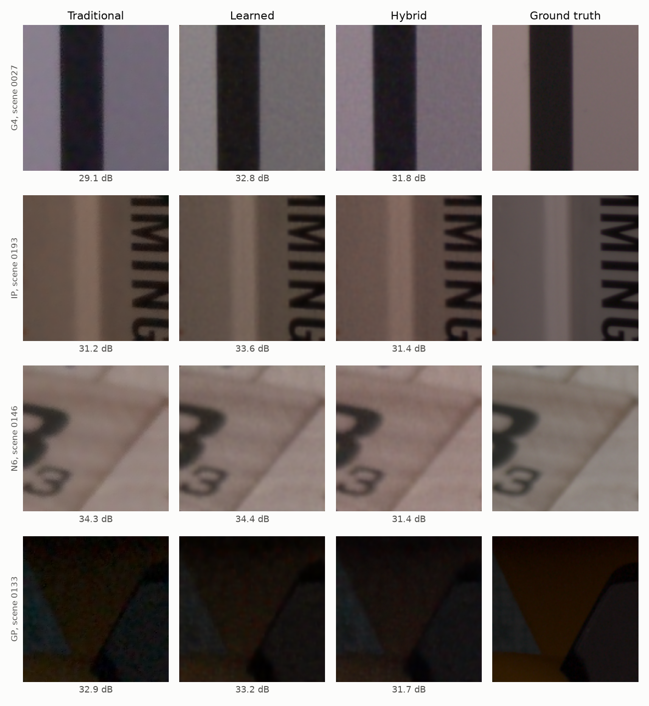
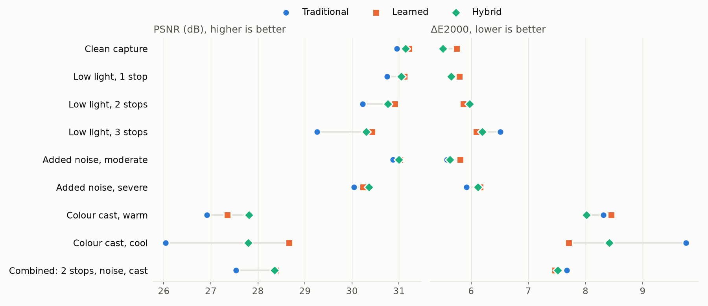
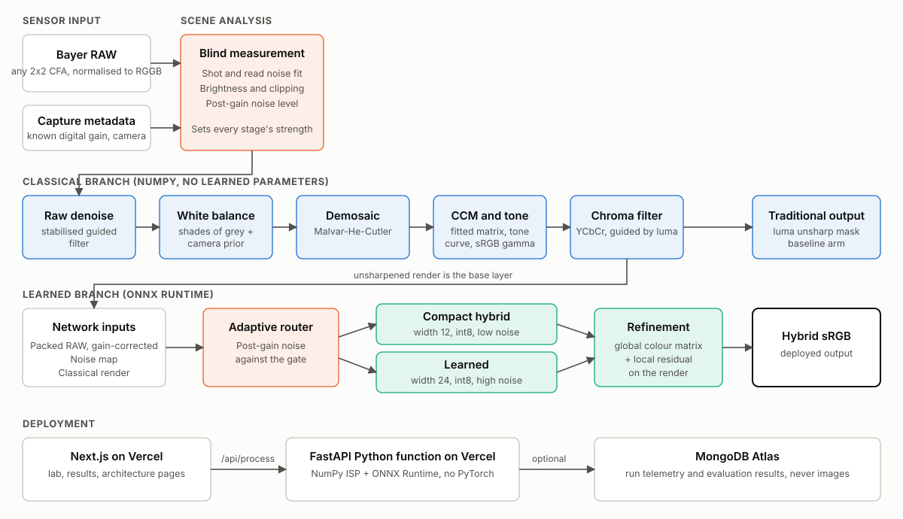
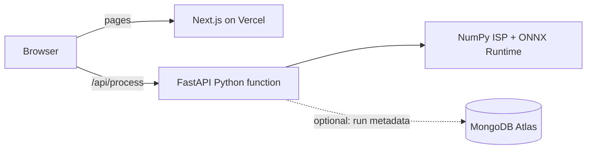
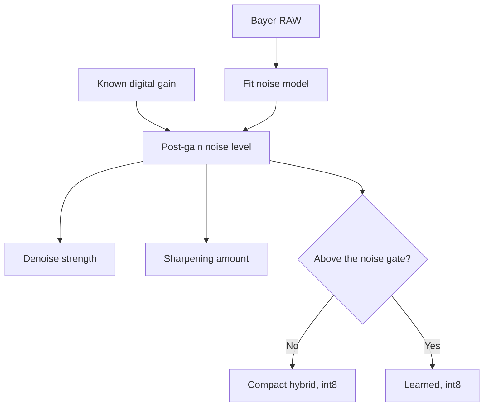

# LumaForge — Hybrid Learned Smartphone ISP

<div align="center">

[](https://github.com/Charis-E-Shiny/LumaForge/actions/workflows/ci.yml)
[](LICENSE)
[](https://www.python.org/)
[](https://pytorch.org/)
[](https://onnxruntime.ai/)
[](https://numpy.org/)
[](https://fastapi.tiangolo.com/)
[](https://nextjs.org/)
[](https://www.mongodb.com/atlas)
[](https://vercel.com/)

**Measure. Render. Refine. Deliver.**

*A hybrid image signal processor that turns noisy smartphone Bayer RAW into faithful sRGB. Classical camera stages supply a physically meaningful render, and a compact neural network corrects only what those stages get wrong.*

[Architecture](docs/ARCHITECTURE.md) • [Design Document](docs/DESIGN.md) • [API Reference](docs/API.md) • [Ablation & Failures](docs/ABLATION_AND_FAILURES.md) • [Datasets](docs/DATASETS.md) • [Reproduce](docs/REPRODUCE.md) • [Deployment](docs/DEPLOYMENT.md)

**[Live Demo](https://lumaforge-one.vercel.app)** • **Team Asphalt (T32) · Problem P2: Intelligent and Computationally Efficient Smartphone ISP**

</div>

> [!IMPORTANT]
> **Project status: live at [lumaforge-one.vercel.app](https://lumaforge-one.vercel.app).** Models, results and documentation are complete. See [Project Status](#-project-status).

---

## 📌 Table of Contents

- [Overview & Problem Statement](#-overview--problem-statement)
- [Project Status](#-project-status)
- [System Architecture](#-system-architecture)
- [Classical ISP Stages](#-classical-isp-stages)
- [LumaNet: The Learned Component](#-lumanet-the-learned-component)
- [Adaptive Processing](#-adaptive-processing)
- [Model Optimization](#-model-optimization)
- [Datasets](#-datasets)
- [Findings From Calibration](#-findings-from-calibration)
- [Evaluation Plan](#-evaluation-plan)
- [Web Application](#-web-application)
- [Testing & Quality](#-testing--quality)
- [Quick Start Guide](#-quick-start-guide)
- [Repository Layout](#-repository-layout)
- [Requirement Coverage](#-requirement-coverage)
- [Team](#-team)
- [Contributing](#-contributing)
- [License & Disclaimer](#-license--disclaimer)
- [Acknowledgements](#-acknowledgements)

---

## 💡 Overview & Problem Statement

### The Problem

1. **Sensors capture degraded data.** A phone sensor records a noisy, colour-cast mosaic in which every pixel measures only one colour.
2. **Conventional pipelines are rigid.** Hand-tuned stages are efficient and predictable, but they cannot restore detail well, and they degrade quickly in low light or under a white-balance error.
3. **Pure neural ISPs are expensive and opaque.** End-to-end models must relearn the whole camera pipeline, which costs parameters, memory and latency that phones do not have. Colour can also drift, because nothing anchors it to the physics of the sensor.

### The LumaForge Solution

| Principle | How it is applied |
|---|---|
| **Physics first** | A classical pipeline renders the image, so colour and tone start from a physically meaningful result |
| **Learn the residual** | The network predicts a global colour correction and a local residual, rather than the whole image |
| **Measure, then adapt** | Noise is fitted from the mosaic itself, and that measurement sets each stage's strength |
| **Spend compute only when needed** | Low-noise captures use a compact hybrid, and noisy captures use a larger learned model. Both are int8 |
| **One implementation everywhere** | The same NumPy ISP runs in training, evaluation and the deployed function, which rules out train/serve skew |

Three arms are compared on identical inputs:

| Arm | Method |
|---|---|
| **Traditional** | The classical pipeline, calibrated on training scenes, so that the baseline is a fair one |
| **Learned** | The same U-Net backbone, mapping packed RAW directly to sRGB |
| **Hybrid** | The classical render plus LumaNet refinement |

---

## 📍 Project Status

| Deliverable | Status |
|---|---|
| Classical ISP, LumaNet, API and web application source | ✅ API tested locally on both routes, web build passes |
| System architecture diagram | ✅ [`public/figures/architecture.svg`](public/figures/architecture.svg) |
| Design document | ✅ [`docs/DESIGN.md`](docs/DESIGN.md) |
| Data cache and camera calibration | ✅ 115 scenes processed, calibration committed |
| Trained models | ✅ 10 runs, 2 deployed |
| ONNX export, int8 and fp16 models | ✅ [`models/`](models/) |
| Comparative evaluation | ✅ [`eval_P2_T32.md`](eval_P2_T32.md) |
| Ablation study and failure-case analysis | ✅ [`docs/ABLATION_AND_FAILURES.md`](docs/ABLATION_AND_FAILURES.md) |
| Live hosted application | ✅ [lumaforge-one.vercel.app](https://lumaforge-one.vercel.app), without MongoDB so far |

## 📊 Results

Measured on 928 held-out blocks from 29 scenes:

| Pipeline | PSNR (dB) | SSIM | ΔE2000 | LPIPS | Model size |
|---|---:|---:|---:|---:|---:|
| Traditional baseline | 30.90 | 0.8557 | 5.53 | 0.3287 | none |
| Learned, int8 | 30.97 | 0.8838 | 5.82 | 0.2230 | 0.73 MB |
| Compact hybrid, int8 | 31.01 | 0.8823 | 5.47 | 0.2124 | 0.29 MB |
| **Hybrid adaptive (deployed)** | **30.92** | **0.8832** | **5.61** | **0.2170** | **0.29 + 0.73 MB** |

- **Clear gains over the baseline:** SSIM +0.0276 and LPIPS -0.1117, with 95% intervals that exclude zero.
- **No reliable change:** PSNR +0.02 dB (95% CI -0.58 to +0.62) and ΔE2000 +0.08 (95% CI -0.32 to +0.43).
- **Gains under stress:** +1.05 dB at 3 stops under, and +0.90 to +1.75 dB under colour casts.
- **Speed:** the compact int8 model takes 82 ms at 512 px on one laptop CPU thread, with 58 MB peak memory. The classical stages add about 320 ms.
- **Selection caveat:** the deployed pair was chosen after a first test run had been seen, using validation data only, so these numbers are not a fully blind estimate.





---

## 🏛 System Architecture



```text
┌────────────────────────────────────────────────────────────────────────────┐
│                               SENSOR INPUT                                 │
│              Bayer RAW (any 2x2 CFA)  +  known digital gain                │
└─────────────────────────────────────┬──────────────────────────────────────┘
                                      ▼
┌────────────────────────────────────────────────────────────────────────────┐
│                              SCENE ANALYSIS                                │
│     Shot and read noise fit   ·   Brightness   ·   Clipped-pixel fraction  │
└─────────────────────────────────────┬──────────────────────────────────────┘
                                      ▼
┌────────────────────────────────────────────────────────────────────────────┐
│                     CLASSICAL BRANCH (NumPy, no weights)                   │
│  Raw denoise ► White balance ► Demosaic ► CCM ► Tone ► Gamma ► Chroma      │
└───────────────┬────────────────────────────────────────────┬───────────────┘
                │ unsharpened render                         │ luma sharpen
                ▼                                            ▼
┌───────────────────────────────────────┐          ┌────────────────────────┐
│    LEARNED BRANCH (ONNX Runtime)      │          │    TRADITIONAL OUTPUT  │
│                                       │          │       (baseline)       │
│  Inputs: packed RAW, noise map, render│          └────────────────────────┘
│                 │                     │
│        ┌────────┴────────┐            │
│        ▼                 ▼            │
│   Compact hybrid   Learned            │
│   width 12, int8   width 24, int8     │
│        └────────┬────────┘            │
│                 ▼                     │
│  Global colour matrix + local residual│
└─────────────────┬─────────────────────┘
                  ▼
           HYBRID sRGB OUTPUT
```

### Deployment



PyTorch is never deployed. Inference needs only NumPy and ONNX Runtime, which keeps the function small. The database is optional, and images are never written to it.

More detail: [docs/ARCHITECTURE.md](docs/ARCHITECTURE.md).

---

## 📷 Classical ISP Stages

Every stage is implemented from scratch in NumPy in [`lumaforge/isp/classical.py`](lumaforge/isp/classical.py).

| # | Stage | Method | Mandatory requirement |
|---|---|---|---|
| 1 | Bayer preprocessing | Normalises any 2x2 CFA to RGGB, and packs to 4 planes | Bayer RAW preprocessing |
| 2 | Raw denoising | Guided filter in a variance-stabilised space | Denoising and edge-preserving filtering |
| 3 | White balance | Shades of grey, shrunk towards a per-camera prior | White balance correction |
| 4 | Demosaicing | Malvar-He-Cutler gradient-corrected interpolation | Demosaicing |
| 5 | Colour correction | Per-camera matrix fitted on training scenes | Colour correction matrix |
| 6 | Tone mapping | Filmic curve on luminance, preserving chromaticity | Tone mapping |
| 7 | Gamma | IEC 61966-2-1 sRGB transfer function | Gamma correction |
| 8 | Chroma filtering | Guided filter on Cb and Cr, using luma as the guide | Colour-space transformations |
| 9 | Sharpening | Unsharp mask on luma with a noise threshold | Image sharpening |

Noise is modelled as heteroscedastic, and fitted per capture from the two green planes:

$$\sigma^2(I) = a \cdot I + b$$

Here $a$ is the shot-noise slope and $b$ is the read-noise floor. Filtering happens after a square-root transform, which approximately equalises noise across brightness levels.

---

## 🧠 LumaNet: The Learned Component

LumaNet is a compact U-Net built from depthwise-separable residual blocks ([`lumaforge/models/lumanet.py`](lumaforge/models/lumanet.py)).

$$\hat{y} = \left(I + \Delta M\right) \cdot r + t + R$$

$r$ is the classical render, $\Delta M$ and $t$ come from a global colour head, and $R$ is the local residual. Both outputs start at zero, so training begins from the classical result and refines it.

| Model | Width | Parameters | Role |
|---|---:|---:|---|
| Compact hybrid | 12 | 152,276 | Fast route, refines an undenoised classical render |
| Learned | 24 | 581,124 | Quality route, has no classical render input |

The learned model still receives classical white-balance gains, exposure and the noise map. It does not receive the classical render.

The teacher, distilled student and fp16 export were built and measured, but are not deployed. The [design document](docs/DESIGN.md#27-two-routed-models-chosen-from-evidence) explains why.

**Inputs:** packed RAW after gain and square-root encoding, a per-pixel noise map, and, for the hybrid, the classical render.

**Training loss:** Charbonnier, SSIM, and an L1 term in CIELAB for colour fidelity. The student adds an L1 distillation term against the teacher.

**Augmentation:** physically motivated degradations in the RAW domain ([`lumaforge/degrade.py`](lumaforge/degrade.py)): underexposure with matching extra noise, added shot and read noise, and colour casts.

---

## 🎛 Adaptive Processing



Digital gain comes from capture metadata and is not estimated. SIDD references keep dark scenes dark, so a blind auto-exposure would wrongly brighten scenes that are meant to be dim. The case where this metadata is missing will be reported as a failure mode.

The noise gate of `0.0284` was tuned on validation scenes by [`scripts/tune_gate.py`](scripts/tune_gate.py). It gives the largest fast-route share, 70%, while mean PSNR stays within 0.05 dB of always using the larger model.

---

## ⚡ Model Optimization

| Technique | Applied to | Purpose |
|---|---|---|
| **Int8 static quantization** | Both deployed models | Reduce size and CPU cost. The output head stays in float to avoid banding |
| **Knowledge distillation** | Student, measured but not deployed | Train a 152k-parameter student from the 587k-parameter teacher |
| **Reduced precision (fp16)** | Teacher, measured but not deployed | Halve the stored weight size |
| **Depthwise-separable blocks** | All models | Reduce operations per layer |

Size, MACs, latency and peak memory are measured by [`scripts/benchmark.py`](scripts/benchmark.py), with each measurement in a fresh process.

---

## 🗂 Datasets

| Source | Use |
|---|---|
| [SIDD-CC](https://huggingface.co/datasets/MhdMohammadi/SIDD-CC) | Training, validation and testing |
| [SIDD](https://abdokamel.github.io/sidd/) | Origin of SIDD-CC. Its download server was unreachable during this work |
| [Modular Neural ISP](https://github.com/SamsungLabs/modular_neural_isp) | Design reference only. The repository contains code and download scripts, not images |

| Split | Scenes | Size |
|---|---:|---|
| Train | 103 | 2,472 crops of 256 × 256 |
| Validation | 12 | 288 crops of 256 × 256 |
| Test (held out) | 29 | 928 blocks of 256 × 256 |

The five sensors are Galaxy S6, Google Pixel, Nexus 6, LG G4 and iPhone 7. Validation scenes are chosen per camera, and the test split is never used for training or tuning.

Dataset files are not stored in this repository. See [docs/DATASETS.md](docs/DATASETS.md).

---

## 🔬 Findings From Calibration

These measurements come from training crops. They are not test results.

| Finding | Evidence | Consequence |
|---|---|---|
| **White balance is the largest classical error** | Sampled crops: 37.1 dB and ΔE76 3.3 with the camera's as-shot white balance, against 30.2 dB and ΔE76 9.5 with plain shades-of-grey | The test split has no metadata, so white-balance robustness matters most |
| **A per-camera prior helps** | Mean illuminant error falls from 7.3° to 4.2° at prior weight 0.8 | Added to the baseline, keeping the comparison fair |
| **Targets have no auto-exposure** | Linear signal maps to target about 1:1, and the fitted tone curve is close to identity | Blind auto-exposure was removed |
| **DNG colour matrices are biased here** | Red about 19% low, blue about 11% high, across cameras | Fitted matrices replaced them |

---

## 📊 Evaluation Plan

Results will appear in `eval_P2_T32.md`, which [`scripts/make_report.py`](scripts/make_report.py) generates from raw outputs, so that no number is typed by hand.

| Measure | Details |
|---|---|
| Fidelity | PSNR, SSIM |
| Colour | CIEDE2000 ΔE |
| Perceptual | LPIPS (AlexNet) |
| Cost | Parameters, model size, MACs, latency, peak memory |
| Confidence | 95% bootstrap intervals over scenes, not blocks |

**Robustness conditions:** clean, 1 to 3 stops of low light, moderate and severe added noise, warm and cool casts, a combined severe case, and missing gain metadata.

**Ablation study:** each classical stage removed in turn, and trained variants without the noise map, colour head, degradation training, colour loss, classical denoise or classical base.

---

## 🖥 Web Application

Built with **Next.js 15**, **TypeScript** and a **FastAPI** Python function.

| Page | Route | Description |
|---|---|---|
| **Lab** | `/` | Pick a test capture or upload an image, degrade it in the RAW domain, and compare the arms with a slider |
| **Results** | `/results` | Evaluation tables, robustness chart, cost table and ablation study |
| **Architecture** | `/architecture` | System diagram and the processing order |

Uploaded JPEG or PNG files are not true RAW. They are converted to a simulated mosaic, the interface labels them as simulated, and they are never stored.

API endpoints are documented in [docs/API.md](docs/API.md).

---

## 🧪 Testing & Quality

```text
pytest: 28 passed, 10 skipped
  - tests/test_classical.py   Demosaicing, filters, colour, noise fit, routing, degradations
  - tests/test_model.py       Identity start, variants, loss, input preparation
  - tests/test_api.py         Skipped until exported models exist
```

GitHub Actions runs Ruff, pytest, the TypeScript check and a production build on every push to `main`.

---

## 🚀 Quick Start Guide

### Prerequisites

- Python 3.11 or newer
- Node.js 22 and npm
- About 30 GB of free disk space for data preparation, which shrinks to about 1 GB afterwards

### 1. Install

```bash
git clone https://github.com/Charis-E-Shiny/LumaForge.git
cd LumaForge

python -m venv .venv
source .venv/bin/activate      # Windows: .venv\Scripts\activate
pip install torch torchvision --index-url https://download.pytorch.org/whl/cpu
pip install -r requirements-train.txt

npm install
```

### 2. Run the Tests

```bash
pytest -q
```

### 3. Reproduce the Models

```bash
python scripts/prepare_sidd_cc.py --out data/cache
python scripts/consolidate_cache.py
python scripts/calibrate.py
python scripts/tune_classical.py --write
sh scripts/run_training.sh
python scripts/export_onnx.py
```

The full sequence, including evaluation, is in [docs/REPRODUCE.md](docs/REPRODUCE.md).

### 4. Run the Application

The application needs the exported models and demo samples from step 3.

```bash
# Terminal 1
npm run dev:api

# Terminal 2
npm run dev
```

Open [http://localhost:3000](http://localhost:3000).

### 5. Optional: MongoDB

```bash
cp .env.example .env.local     # then set MONGODB_URI
```

---

## 📁 Repository Layout

```text
LumaForge/
├── api/                  FastAPI function and optional MongoDB storage
├── app/                  Next.js pages
├── components/           Lab, comparison slider, results, telemetry
├── docs/                 Architecture, design, API, datasets, reproduction, deployment
├── lumaforge/            Core Python package
│   ├── isp/              Classical stages, scene analysis, calibration
│   ├── models/           LumaNet
│   ├── degrade.py        RAW-domain degradations
│   ├── hybrid.py         Shared input preparation
│   ├── metrics.py        Evaluation metrics and losses
│   └── runtime.py        ONNX inference
├── public/figures/       Diagram and report figures
├── scripts/              Data, calibration, training, export, evaluation, reporting
├── tests/                Unit and API tests
├── requirements.txt      Deployed function dependencies
└── requirements-train.txt  Full development dependencies
```

---

## ✅ Requirement Coverage

| Requirement | Implementation | State |
|---|---|---|
| **A. Classical computer vision** | [`lumaforge/isp/`](lumaforge/isp/) | ✅ Implemented |
| **B. Deep learning** | [`lumaforge/models/lumanet.py`](lumaforge/models/lumanet.py), [`scripts/train.py`](scripts/train.py) | ✅ Trained |
| **C. Hybrid architecture** | [`lumaforge/hybrid.py`](lumaforge/hybrid.py), [`lumaforge/runtime.py`](lumaforge/runtime.py) | ✅ Evaluated |
| Adaptive pipeline | [`lumaforge/isp/analysis.py`](lumaforge/isp/analysis.py) | ✅ Gate tuned on validation |
| RAW-to-RGB reconstruction | Whole pipeline | ✅ Evaluated |
| Optimization | [`scripts/export_onnx.py`](scripts/export_onnx.py) | ✅ Measured |
| Size, memory and latency | [`scripts/benchmark.py`](scripts/benchmark.py) | ✅ Measured |
| Degradation and recovery | [`scripts/evaluate.py`](scripts/evaluate.py) | ✅ Measured |
| Comparison with conventional baseline | [`scripts/evaluate.py`](scripts/evaluate.py) | ✅ Measured |

---

## 👥 Team

**Team Asphalt, T32, Problem P2**

| USN |
|---|
| 1RUA24CSE0100 |
| 1RUA24CSE0109 |
| 1RUA24CSE0111 |
| 1RUA24CSE0114 |
| 1RUA24CSE0098 |

---

## 🤝 Contributing

Contributions are welcome. Please read [CONTRIBUTING.md](CONTRIBUTING.md) and the [Code of Conduct](CODE_OF_CONDUCT.md). Report vulnerabilities as described in [SECURITY.md](SECURITY.md). Changes are recorded in the [Changelog](CHANGELOG.md).

---

## 📄 License & Disclaimer

The source code is licensed under the **MIT License**. See [LICENSE](LICENSE).

Datasets and third-party work keep their own terms, and are not covered by that license. See [THIRD_PARTY_NOTICES.md](THIRD_PARTY_NOTICES.md).

> ⚠️ **Academic disclaimer:** LumaForge is an educational project. It is not a production camera pipeline. Test images come from a research dataset whose terms limit use, so check those terms before reusing any data.

---

## 🙏 Acknowledgements

- Abdelhamed, Lin and Brown for the [Smartphone Image Denoising Dataset](https://abdokamel.github.io/sidd/)
- The authors of [SIDD-CC](https://huggingface.co/datasets/MhdMohammadi/SIDD-CC)
- Afifi, Wang, Zhang and Brown for [Modular Neural Image Signal Processing](https://github.com/SamsungLabs/modular_neural_isp)
- Malvar, He and Cutler for demosaicing, He et al. for the guided filter, and Zhang et al. for LPIPS
