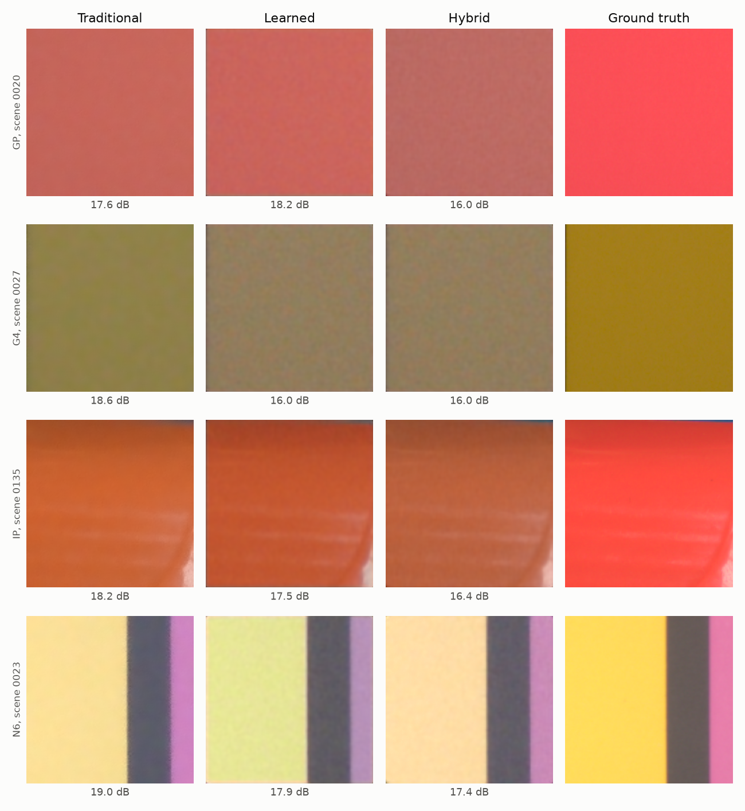
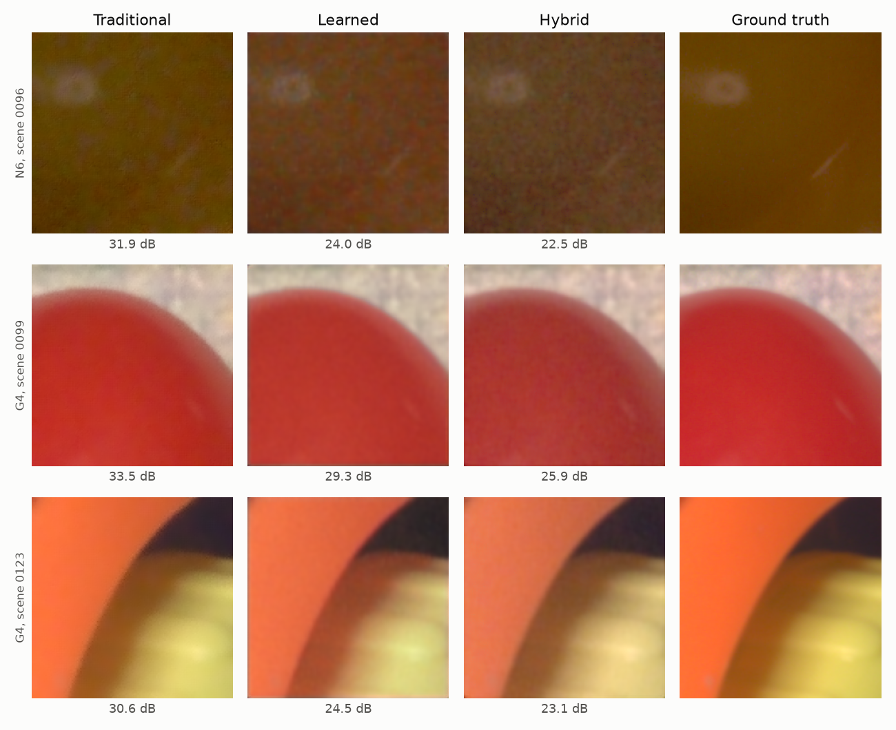

# Ablation Study and Failure Analysis

All numbers come from `results/*.json`. Full tables are in [`eval_P2_T32.md`](../eval_P2_T32.md).

## Key Findings

1. **The deployed system improves structure and perceived quality, not fidelity or colour.** Against the classical baseline over 29 test scenes, SSIM rose by 0.0276 and LPIPS fell by 0.1117, and both 95% intervals exclude zero. PSNR (+0.02 dB) and ΔE2000 (+0.08) are statistically level with the baseline.
2. **The biggest design change came from this study.** Removing the classical denoiser from the hybrid's input gave a large gain, so the deployed compact model works that way.
3. **White balance is the main unsolved problem.** It is the largest single classical stage, and it causes most of the worst failures.

## Method

- **Classical ablation:** one stage is removed from the pipeline at a time.
- **Trained ablation:** seven width-12 models were trained for 2,000 iterations with the same seed, each with one change.
- **Test data:** every fourth test block, which gives 232 blocks. Trained variants are scored on clean captures and on the combined severe condition (2 stops under, added noise and a warm cast).

**Limits:** each variant has one seed, so differences under about 0.1 dB should not be treated as real. The study has no repeat runs and no confidence intervals. Trained variants were measured against the original design, with a denoised base, so they do not show each component's value inside the deployed compact model.

## Classical Stage Removal

| Removed stage | PSNR change (dB) | ΔE2000 change | LPIPS change | Effect |
|---|---:|---:|---:|---|
| White balance | -8.71 | +12.26 | +0.169 | Largest loss in the pipeline |
| Raw denoising | -4.55 | +1.01 | +0.414 | SSIM falls from 0.853 to 0.497 |
| Colour matrix | -2.12 | +1.97 | +0.027 | Colour error rises sharply |
| Chroma filter | -0.40 | +0.36 | -0.008 | Small fidelity loss, slightly better LPIPS |
| Adaptive control | -0.30 | +0.17 | +0.041 | Fixed settings lose texture and fidelity |
| Tone mapping | -0.12 | +0.01 | -0.001 | Almost no effect, because the fitted curve is close to identity |

The tone stage earns very little on this dataset. That is a property of SIDD's targets, which are close to linear signal with gamma, and it would not hold for a phone's own rendering style.

## Trained Variants

| Variant | Clean PSNR | Clean SSIM | Clean ΔE | Clean LPIPS | Severe PSNR | Severe ΔE |
|---|---:|---:|---:|---:|---:|---:|
| All components, denoised base | 31.06 | 0.855 | 5.33 | 0.323 | 27.37 | 7.69 |
| No noise map | 30.99 | 0.855 | 5.37 | 0.324 | 27.10 | 7.97 |
| No colour head | 30.85 | 0.854 | 5.47 | 0.328 | 27.08 | 7.98 |
| No degradation training | 31.06 | 0.856 | 5.35 | 0.324 | 27.14 | 7.91 |
| No Lab colour loss | 31.29 | 0.868 | 5.28 | 0.267 | 28.00 | 7.36 |
| **No classical denoise (deployed as compact)** | 31.21 | 0.884 | 5.38 | 0.221 | 28.52 | 7.20 |
| No classical base (learned only) | 30.41 | 0.874 | 6.65 | 0.273 | 27.49 | 8.59 |

### What This Shows

- **The classical denoiser was hurting the hybrid.** It removes fine texture before the network sees it, and the network cannot restore that. Without it, LPIPS fell from 0.323 to 0.221, and severe-condition PSNR rose by 1.15 dB.
- **The classical base is still worth keeping at small sizes.** At the same width, the undenoised hybrid beats the learned-only model by 0.80 dB and 1.27 ΔE on clean captures. This is the strongest evidence for the hybrid design.
- **The Lab colour loss did not help as used.** Removing it improved every metric shown, including ΔE, which is the metric it targets. This is one seed, and the cause was not investigated.
- **The noise map, colour head and degradation training matter mostly under stress.** Each is worth about 0.24 to 0.29 dB in the severe condition. On clean captures the effect ranges from nothing to 0.21 dB.

## How the Design Changed

| Stage | Change | Evidence |
|---|---|---|
| First test run | Distilled student and teacher on a denoised base | 30.91 dB, SSIM 0.856, LPIPS 0.324: almost the same as the baseline |
| Validation ranking | Checkpoints ranked on four metrics, `scripts/select_model.py` | Learned first, undenoised hybrid second, 0.12 dB behind |
| Deployed pair | Compact hybrid on the fast route, learned on the quality route | Rule winner kept for noisy captures, compact hybrid kept for efficiency |
| Gate | Tuned on validation, `scripts/tune_gate.py` | `0.0284` |

**Caveat:** this redesign happened after test results had been seen. The ranking and gate used validation scenes only, but the final test numbers are not a fully blind estimate.

## Failure Cases

Scenes are the independent unit: the deployed system beats the baseline on PSNR in 17 of 29 scenes and loses in 12. Scene-level PSNR changes run from -3.61 dB to +3.14 dB.

### 1. Saturated, single-colour surfaces

**What happens:** the worst blocks score 16 to 17 dB. Reds and yellows come out dull in every pipeline.

**Likely cause:** with one dominant colour, the grey-world style white-balance estimate has nothing neutral to use, and it treats the object's colour as a colour cast. Test crops are 256 px, which gives little scene context. The worst blocks fit this explanation, but illuminant error was not measured for them.

**Direction:** whole-image white-balance statistics instead of per-crop ones, or the as-shot white balance a real phone already has. On training crops, as-shot white balance gave 37.1 dB against 30.2 dB for plain shades-of-grey.

### 2. Colour regressions from the network

**What happens:** on some blocks the network moves colour further from the target than the classical render. In scene 0023, the learned model turns a yellow surface green. Scene 0123 is the largest scene-level loss, at -3.61 dB.

**Likely cause:** on a block with little context, the network has no reliable cue and can apply the wrong correction. This is why PSNR does not improve overall, despite the gains in structure.

### 3. Missing gain metadata

**What happens:** a capture 2 stops under, with no gain supplied, scores about 17 dB and ΔE 15 in both the traditional and hybrid pipelines. With the gain supplied, the hybrid scores 30.76 dB.

**Cause:** this is by design, because gain is an input and not estimated. Blind auto-exposure was rejected because SIDD keeps dark scenes dark.

**Direction:** always read gain from metadata. For uploads, which lack it, results are simulated and the app marks them as such.

### 4. Colour casts

**What happens:** a strong cast costs about 3 to 5 dB in every pipeline. The hybrid recovers some of it: +0.90 dB warm and +1.75 dB cool against the baseline. The learned model is better on cool casts, at 28.66 dB against 27.79 dB.

### 5. Weaker results on some cameras

| Camera | Blocks | Baseline PSNR | Deployed PSNR | Baseline ΔE | Deployed ΔE |
|---|---:|---:|---:|---:|---:|
| Google Pixel | 288 | 29.17 | 29.36 | 6.21 | 6.28 |
| Nexus 6 | 192 | 30.06 | 30.12 | 6.11 | 6.51 |
| LG G4 | 224 | 32.52 | 31.94 | 4.50 | 4.71 |
| iPhone 7 | 192 | 31.85 | 32.28 | 5.28 | 5.03 |
| Galaxy S6 | 32 | 34.42 | 34.33 | 4.80 | 4.08 |

The LG G4 loses 0.58 dB. The Galaxy S6 has only 32 blocks, from a single scene, so its row is weak evidence.

### 6. The routing gate did not transfer fully

**What happens:** on validation, routing beat both models used alone at low gates. On test, the compact int8 model alone (31.01 dB, ΔE 5.47) beat the routed system (30.92 dB, ΔE 5.61). The routed system's LPIPS, 0.2170, was also slightly worse than compact alone, 0.2124.

**Implication:** the learned model's advantage on noisy captures is real under degradation, but on clean test captures the routing added cost without a measured gain. The difference is small, and no confidence interval was computed for it.

## Why Validation PSNR Stalled at 30 dB

Training logs showed validation PSNR flat from about step 1,000, and models with similar validation PSNR later differed clearly in SSIM and LPIPS. The likely reason is that mean PSNR here is dominated by global colour error, which the network cannot reliably remove from small crops. Checkpoint selection used PSNR only, so it could not see those texture differences. `scripts/select_model.py` fixes this by ranking on all four metrics.

The first 32-block trial was also misleading. It suggested a +2.4 dB gain, but all 32 blocks came from scene 0020, which is the deployed system's best scene. Only the full run should be cited.

## Limits

- The evaluation covers one dataset, SIDD-CC, with five phone cameras.
- Test blocks carry no capture metadata, so white balance is always blind. A real phone would do better.
- Training ran on a CPU laptop for a short budget, and the ablation models used 2,000 iterations.
- Latency was measured on a laptop CPU, not a phone.
